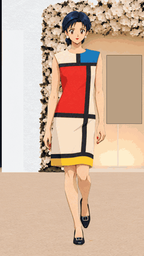
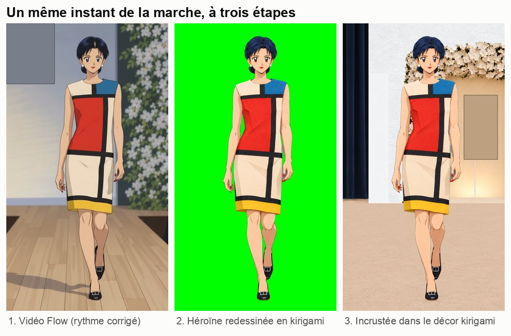
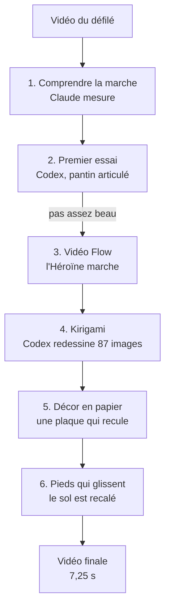
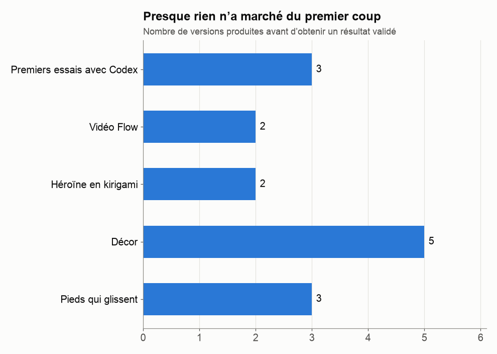

# Faire défiler une héroïne d'anime avec trois IA

**Un projet d'intelligence artificielle raconté pas à pas, pour les lycéennes et lycéens qui veulent se lancer.**

On est partis d'une vidéo de défilé de mode et on voulait obtenir une héroïne d'anime, faite de papier découpé (le *kirigami*), qui défile exactement comme la mannequin. Pour y arriver, trois IA ont travaillé ensemble pendant deux jours : **Claude**, **Codex** et **Google Flow**. Une personne, à la direction artistique (la « DA »), prenait toutes les décisions.

Rien n'a marché du premier coup. Ce dépôt raconte **ce qui a raté, pourquoi, et comment on s'en est sortis**, pour que tu puisses réutiliser la méthode dans ton propre projet.

  

<em>Le résultat : 87 dessins, 7,25 secondes, un seul plan. Le GIF se lit une fois : recharge la page pour le revoir, ou ouvre <a href="images/resultat_final.mp4">la vidéo</a>.</em>

> **Noms de code.** Le défilé, la robe et le personnage appartiennent à d'autres personnes. Dans ce dépôt, on parle donc de **« la Maison »** (la maison de couture), de **« la robe à aplats »** (une robe à grands rectangles rouge, bleu et jaune séparés par des bandes noires), de **« l'Héroïne »** (le personnage d'anime) et d'**« escarpins à boucle »**. Le monogramme de la Maison est **flouté** sur toutes les images. Aucune image du vrai défilé ni de la vraie mannequin n'est publiée : on ne montre que des schémas et des images produites par les IA.

---

## En une image

1. **Google Flow** fabrique une vidéo où l'Héroïne reproduit la marche du défilé.
2. **Codex** redessine chaque image de cette vidéo en papier découpé, une par une.
3. Un **décor** en papier, lui aussi fabriqué par Codex, est ajouté derrière elle, avec une caméra qui recule pendant qu'elle avance.

## Les trois IA et la DA

| Qui | Son rôle, comme dans une équipe | Ce qu'il fait bien | Ce qu'il fait mal |
|---|---|---|---|
| **La DA** (une personne) | La direction du projet : c'est elle qui décide | Juger si c'est beau, trancher | Impossible de tout mesurer à l'œil |
| **Claude** (Anthropic) | L'assistant d'analyse et de contrôle | Analyser une vidéo, mesurer, écrire des consignes précises, vérifier | Il ne génère pas d'images, et il s'est trompé plusieurs fois dans ses consignes |
| **Codex** (OpenAI) | L'atelier de fabrication | Écrire et lancer des programmes, générer des images avec GPT Image | Il invente des détails, et il faut tout lui expliquer |
| **Google Flow** | Le studio vidéo | Créer une vidéo fluide d'un personnage qui marche | Rythme approximatif, refus de certaines demandes, détails flous |

Chaque IA a son point faible. Le projet fonctionne parce que **chacune vérifie le travail d'une autre**, et que la DA a le dernier mot.

## Le chemin complet

Chaque étape a son chapitre, avec ses problèmes et ses solutions :

| Chapitre | De quoi ça parle |
|---|---|
| [1. L'idée et les règles du jeu](docs/01-idee-et-regles.md) | Le but, les contraintes, les droits d'auteur |
| [2. Faire travailler trois IA ensemble](docs/02-trois-ia-qui-collaborent.md) | Qui fait quoi, comment elles se passent le travail |
| [3. Comprendre une marche](docs/03-comprendre-la-marche.md) | Images par seconde, pas, ourlet : mesurer avant de dessiner |
| [4. Premier essai : le pantin articulé](docs/04-premier-essai-pantin.md) | Pourquoi un résultat « juste » peut être raté |
| [5. La vidéo Flow](docs/05-la-video-flow.md) | Un refus, un rythme trop lent, et comment on les a contournés |
| [6. L'Héroïne en papier découpé](docs/06-heroine-en-kirigami.md) | 87 dessins générés un par un, contrôlés un par un |
| [7. Le décor](docs/07-le-decor.md) | Scintillement, porte inventée, logo caché, triangle noir… |
| [8. Les pieds qui glissent](docs/08-les-pieds-qui-glissent.md) | Le défaut le plus subtil, et sa correction |
| [9. À toi de jouer : la méthode](docs/09-ta-methode.md) | La recette réutilisable pour ton propre projet |
| [10. Petit glossaire](docs/10-glossaire.md) | Les mots techniques expliqués simplement |

## Quelques chiffres

- **2 jours** de travail, du 24 au 26 octobre 2026.
- **87 dessins** de l'Héroïne, chacun généré séparément, puis vérifié.
- **15 versions** produites avant d'obtenir un résultat validé. Il a fallu recommencer à chaque étape.
- **3 vidéos** demandées à Flow, dont **1 refusée** par sa sécurité.
- Plus de **100 générations d'images** par Codex, essais ratés compris.

## Ce que tu peux retenir tout de suite

1. **Découpe le travail en petites étapes**, et confie chaque étape à l'outil qui la fait le mieux.
2. **Fais toujours un essai court** (ici 14 images sur 87) avant de lancer tout le travail.
3. **Mesure, ne te contente pas de regarder.** Beaucoup de défauts ne se voient pas sur une image fixe : ils apparaissent dans les mesures, ou seulement quand l'animation tourne.
4. **Écris tes consignes comme pour quelqu'un qui ne sait rien.** Une IA ne devine pas ce que tu as en tête.
5. **Garde toutes les versions.** On revient souvent en arrière.
6. **L'humain décide.** Les IA proposent, mesurent et fabriquent ; c'est la DA qui choisit.

La méthode complète est dans [le chapitre 9](docs/09-ta-methode.md).

## Projet voisin

Le même type de chaîne a servi pour un autre projet public, avec une autre héroïne et un autre défilé : [Bakann/elfluxe](https://github.com/Bakann/elfluxe). Certaines leçons de ce projet-là ont directement servi ici (chapitre 6).

## Ce qui n'est pas publié

Pour respecter les droits d'auteur et le droit à l'image, ce dépôt ne contient :
- ni la vidéo du défilé, ni aucune image de la vraie mannequin ;
- ni les photos de référence (décor, chaussures) ;
- ni l'image du personnage fournie au départ ;
- ni les programmes et fichiers de travail, dont les noms de dossiers contiennent les vrais noms.

Les images publiées ont été produites par les IA pendant le projet. Le monogramme de la Maison y est flouté.
