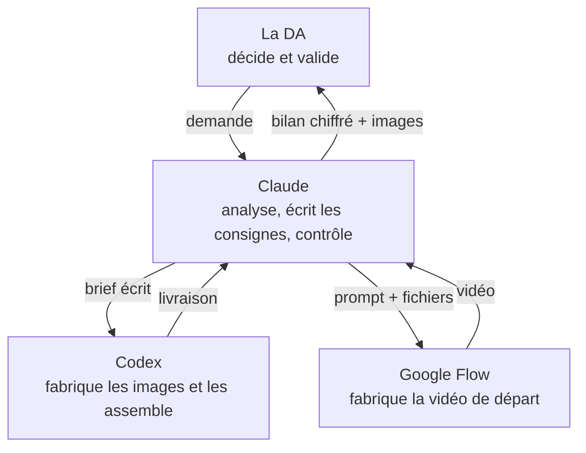
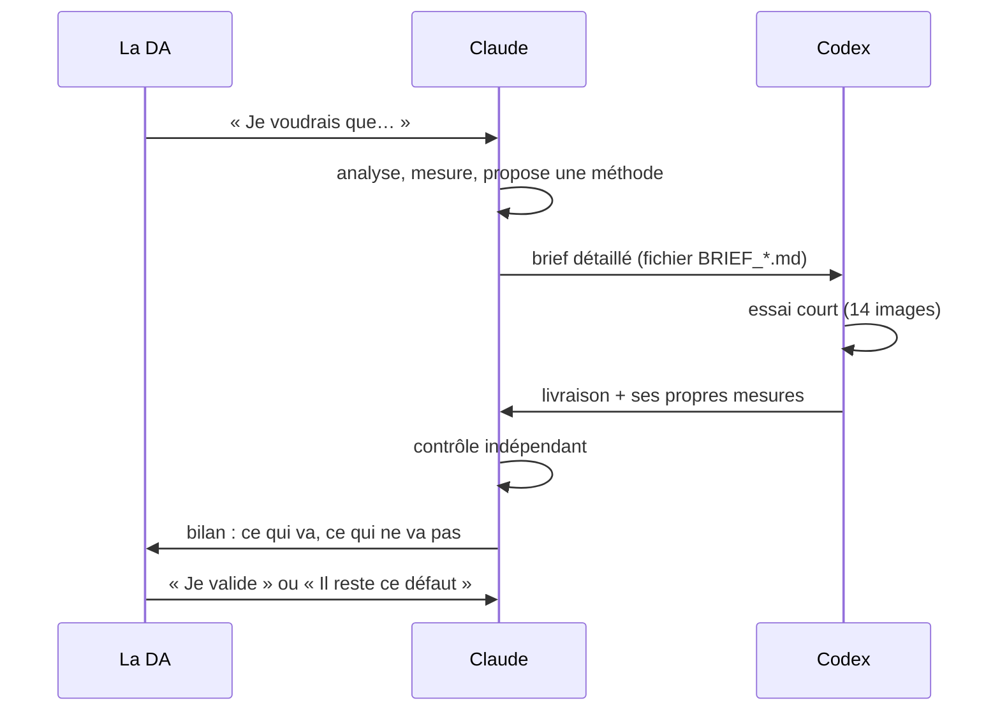

# 2. Faire travailler trois IA ensemble

[← Chapitre précédent](01-idee-et-regles.md) · [Sommaire](../README.md) · [Chapitre suivant →](03-comprendre-la-marche.md)

## Pourquoi trois IA et pas une seule ?

Parce qu'aucune ne fait tout bien. Dans ce projet, chacune avait un rôle précis :

- **Google Flow** génère des **vidéos** très fluides, mais on ne contrôle pas chaque image.
- **Codex** organise la fabrication : il écrit et lance des programmes, et utilise **GPT Image** pour produire les images fixes, une génération par dessin.
- **Claude** ne fabriquait pas les images du projet. Il **analysait** les vidéos, **mesurait** avec des programmes, **écrivait les consignes** et **vérifiait** le travail des autres.

Ces rôles sont ceux de notre organisation, pas des limites universelles des outils.

Comme dans une vraie équipe, chacun a son métier :

## Une boucle qui se répète

Toute l'aventure suit la même boucle, répétée une quinzaine de fois :

Trois détails comptent beaucoup.

**1. Le brief est un fichier.** Claude écrit les consignes dans un fichier texte (par exemple `BRIEF_KIRIGAMI.md`) rangé dans le dossier du projet. Codex le lit, il reste disponible quand on revient plus tard, et on peut le corriger. C'est bien plus fiable qu'un long message de discussion.

**2. Codex s'arrête après l'essai.** Chaque brief se termine par « livre un essai sur une foulée, puis ARRÊTE-TOI et attends la validation ». Sans cette phrase, Codex enchaînerait tout seul les 87 images.

**3. Le contrôle est fait par une autre IA.** Codex vérifie lui-même son travail, mais Claude refait ses propres mesures avec ses propres programmes. Plusieurs défauts n'ont été vus que comme ça. Par exemple, le liseré vert autour de l'Héroïne (chapitre 8) avait échappé au contrôle de Codex, parce que son seuil ne cherchait que du vert franc.

## Comment les IA se passaient le travail, concrètement

- **Claude et Codex partagent un dossier** sur l'ordinateur. Claude y dépose les briefs et les fichiers d'entrée ; Codex y dépose ses résultats.
- **Claude écrivait dans la fenêtre de Codex** grâce à un outil qui lui permet de piloter les applications de l'ordinateur. La DA pouvait aussi copier-coller les messages.
- **Claude pilotait Google Flow** dans le navigateur de la DA, connecté à son compte. Il demandait l'accord de la DA avant chaque génération, puisque chaque vidéo coûte des crédits.
- **Claude surveillait le dossier** de Codex en arrière-plan et reprenait la main dès qu'une livraison apparaissait.

> **Pour ton projet :** tu n'as pas besoin de cette automatisation. Tu peux jouer toi-même le rôle de « facteur » en copiant les consignes d'une IA à l'autre. L'important, c'est la boucle : **demander → essayer petit → mesurer → décider**.

## Les IA se trompent aussi : même celle qui contrôle

Claude a fait plusieurs erreurs dans ses consignes pendant le projet. On les raconte toutes dans les chapitres suivants, parce qu'elles sont instructives :

- il a décrit des chaussures « semelle visible » alors qu'on voyait le dessus (chapitre 4) ;
- il a demandé un sol qui défile « vers le bas » alors qu'il remonte (chapitre 7) ;
- il a demandé une « coulisse noire », que Codex a transformée en porte (chapitre 7) ;
- il a mal placé un genou sur une image (chapitre 3).

Chaque fois, l'erreur a été repérée soit par la DA, qui regarde le résultat, soit par Codex, qui a posé une question. **C'est pour ça que chaque étape passe par plusieurs regards.**

[Chapitre suivant : comprendre une marche →](03-comprendre-la-marche.md)
