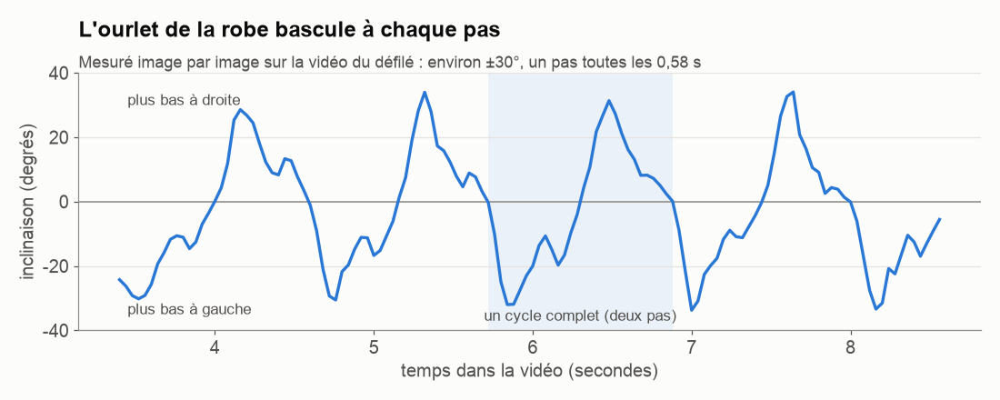
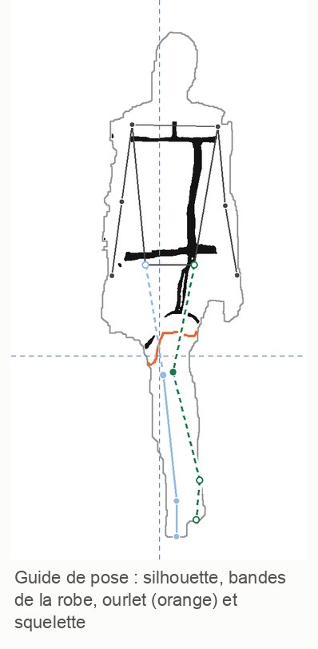

# 3. Comprendre une marche avant de la dessiner

[← Chapitre précédent](02-trois-ia-qui-collaborent.md) · [Sommaire](../README.md) · [Chapitre suivant →](04-premier-essai-pantin.md)

Avant de demander à une IA de dessiner quoi que ce soit, il faut **comprendre ce qu'on veut reproduire**. Ici, c'est une démarche de défilé et la façon dont la robe bouge.

## Une vidéo, c'est une suite d'images

Une vidéo, ce n'est qu'une suite de photos qui défilent très vite. La vidéo du défilé en contient **25 par seconde** (on dit 25 « i/s », images par seconde). Claude a utilisé **ffmpeg**, un logiciel gratuit, pour extraire ces images.

Pour essayer toi-même : installe FFmpeg, place une vidéo que tu as le droit d'utiliser dans un dossier de projet, renomme-la `defile.mp4`, puis crée dans ce dossier un sous-dossier `images`. Ouvre le terminal dans le dossier du projet. Attention : dans les commandes, les nombres décimaux s'écrivent avec un point (`3.4`, pas `3,4`).

```bash
# extraire toutes les images entre 3,4 s et 8,6 s
ffmpeg -ss 3.4 -to 8.6 -i defile.mp4 images/f_%04d.png

# fabriquer une planche-contact : 2 images par seconde, en grille 7 × 4
ffmpeg -i defile.mp4 -vf "fps=2,scale=320:-1,tile=7x4" -frames:v 1 planche.png
```

La **planche-contact**, qui montre beaucoup d'images sur une seule feuille, permet de repérer d'un coup d'œil le bon passage : la mannequin marche seule, de face, sans être cachée.

## Trouver un cycle de marche

Quand on marche, le mouvement se répète tous les **deux pas** : pied gauche, pied droit, puis de nouveau pied gauche. Ces deux pas forment un **cycle**, ou **foulée**. Si on reproduit un cycle parfaitement, on peut le répéter.

Pour mesurer ce cycle, Claude a utilisé un repère simple : **la bande jaune en bas de la robe**. Un petit programme Python repère les pixels jaunes sur chaque image, puis calcule l'inclinaison de leur bord.



Ce que dit ce graphique :
- l'ourlet **bascule d'environ 30°** d'un côté puis de l'autre ;
- il le fait **à chaque pas**, avec un pas toutes les **0,58 seconde** ;
- un cycle complet (zone bleutée) dure **1,16 seconde**.

> **Leçon :** une courbe montre en une image ce qu'il faudrait des minutes de vidéo pour voir. Et ces chiffres serviront ensuite de **référence** pour vérifier tout le reste.

## Stabiliser sur le buste

La mannequin avance vers la caméra : elle grossit à l'écran. Pour comparer les images entre elles, Claude a **recadré chaque image sur le buste** (le grand rectangle rouge de la robe), à la même taille. Résultat : le buste reste immobile, et **tout ce qui bouge encore**, jambes, ourlet, plis, est le vrai mouvement de la marche.

## Passer à 12 dessins par seconde

Les animés japonais sont souvent dessinés « en deux » : chaque dessin est montré deux fois de suite. On a donc **12 dessins différents par seconde**, au lieu de 24. Ça donne un mouvement un peu saccadé, caractéristique.

Pour cet essai, Claude a gardé **une image sur deux** de la vidéo du défilé. Attention au calcul : 25 ÷ 2 = **12,5** images par seconde de vidéo source, pas 12. Un cycle donne ainsi **14 dessins**. On les lit ensuite à 12 dessins par seconde : 14 ÷ 12 ≈ 1,167 s, presque exactement la durée du cycle mesuré.

Pour obtenir directement 12 dessins par seconde, ffmpeg a un filtre, `fps=12`, qui choisit les images aux bons instants. On s'en sert au chapitre 5.

## Le squelette : quand l'ordinateur confond les jambes

Pour aider les IA de dessin, il faut leur donner la position des **articulations** : épaules, hanches, genoux, chevilles. Claude a utilisé **MediaPipe**, un outil gratuit de Google qui repère automatiquement le squelette d'une personne sur une photo.

Pour le haut du corps, il a très bien marché. Pour les pieds, il s'est trompé à chaque fois que les jambes se croisaient : il collait les deux pieds ensemble, ou mettait le pied levé à la place du pied posé.

**Solution :** Claude a suivi directement les **chaussures noires** sur le sol, avec une règle de bon sens : *pendant un appui, le point de contact reste fixe sur le sol*. C'est cette règle qui permet de savoir quel pied est lequel quand ils se croisent.

Attention : il reste fixe **par rapport au sol**, pas forcément dans l'image. Quand la caméra bouge, ou quand on recadre sur le buste, ses coordonnées dans l'image changent. Il faut donc comparer le pied et le sol dans le même repère, et distinguer le talon de la pointe quand le pied se déroule (on y reviendra au chapitre 8).

### L'histoire de la jambe verte

Avant même ce travail, Codex avait dessiné un squelette sur **une seule image** du défilé. La DA a remarqué que **la jambe verte était mal tracée**.

1. Claude a regardé les images **avant et après** ce moment dans la vidéo. Les pieds étaient **inversés** : Codex pensait que les jambes se croisaient, alors qu'elles ne se croisaient pas encore.
2. Claude a envoyé la correction… mais en estimant lui-même la position du genou, **il l'a placé à environ 14 pixels du vrai genou** (dans l'image source de 640 × 480).
3. La DA a placé un **point rouge à la main** sur le vrai genou. C'est ce point qui a servi, sans déplacer les autres repères.

> **Leçon :** sur une image fixe, une jambe croisée et une jambe décroisée se ressemblent. Il faut regarder **les images voisines** pour comprendre le mouvement. Et quand une position compte vraiment, un clic humain vaut mieux qu'une estimation.

## Qui passe devant ?

Autre question de la DA : *« Est-ce que les tracés bleu et vert indiquent si une jambe passe devant l'autre ? »* Ils ne l'indiquaient pas, et le vert était toujours dessiné par-dessus le bleu, ce qui pouvait tromper.

Correction : la **jambe de devant** est dessinée par-dessus, avec un **liseré blanc**. La jambe de derrière est plus pâle. Chaque image indique aussi « jambe avant : bleue » ou « verte ».



Ce **guide au trait** (silhouette, bandes de la robe, ourlet en orange, squelette) transmet la pose aux IA de dessin sous forme de tracés. Certaines étapes ont aussi utilisé des références photographiques privées (chapitres 4 et 5) ; elles ne sont pas publiées dans ce dépôt.

## Ce que ce chapitre a produit

- Un cycle de **14 dessins**, à 12 dessins par seconde.
- Pour chaque dessin : la position des articulations, la jambe de devant, le pied d'appui, l'inclinaison de l'ourlet. Tout est rangé dans un fichier de données ([JSON](10-glossaire.md), voir le glossaire).
- Des **guides au trait** pour chaque dessin.

[Chapitre suivant : premier essai, le pantin articulé →](04-premier-essai-pantin.md)
