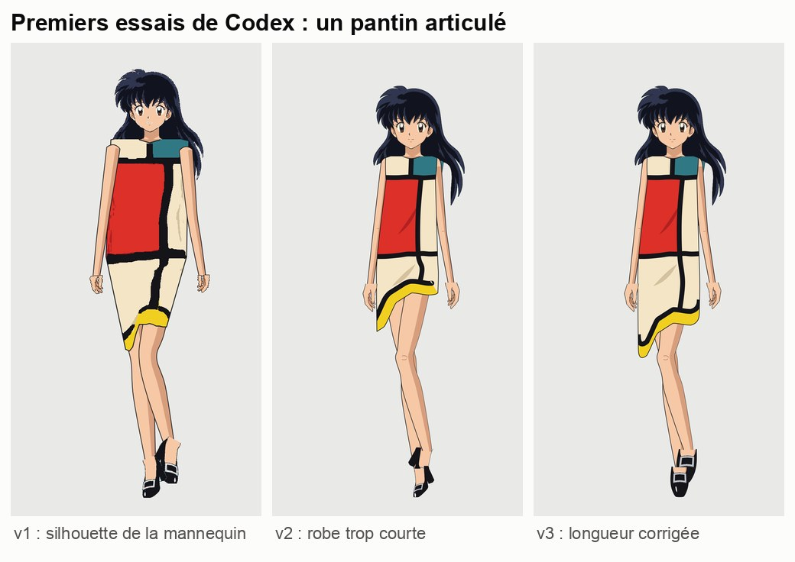
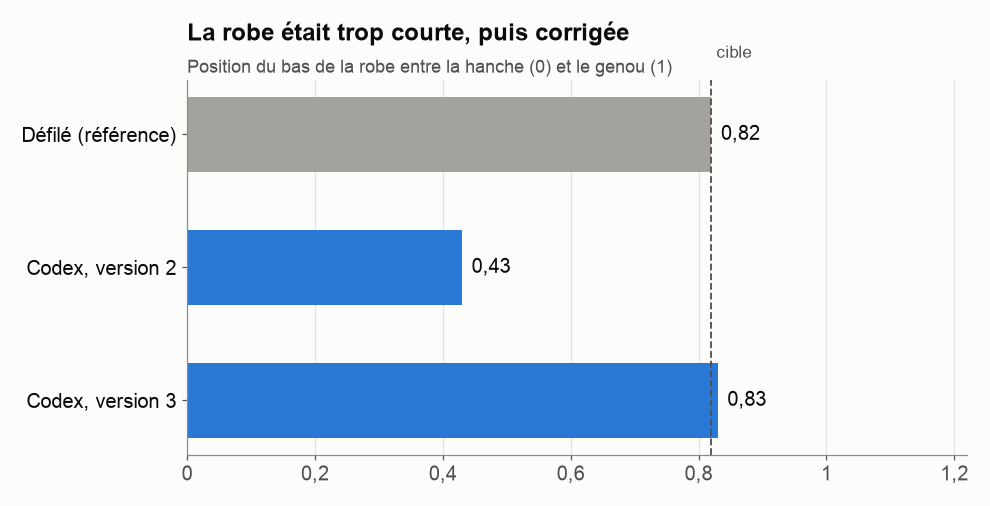
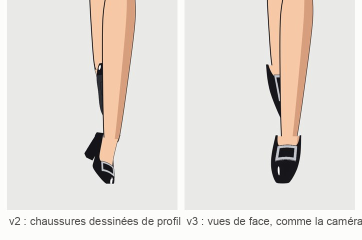

# 4. Premier essai : le pantin articulé

[← Chapitre précédent](03-comprendre-la-marche.md) · [Sommaire](../README.md) · [Chapitre suivant →](05-la-video-flow.md)

## La demande

Avec les 14 guides du chapitre 3, la DA a demandé à Codex un premier essai : faire défiler l'Héroïne avec la robe à aplats, image par image. Claude a écrit un brief : apparence du personnage, description précise de la robe, règles de mouvement (le pied d'appui ne glisse pas, l'ourlet bascule du côté du genou qui avance…), et un **tableau des 14 dessins** avec, pour chacun, la jambe de devant et l'angle de l'ourlet.

## Ce que Codex a fait

Codex a d'abord essayé de **redessiner chaque image** avec GPT Image. Résultat : la robe raccourcissait et les pieds se décalaient d'une image à l'autre. Il a donc changé de méthode et fabriqué un **pantin articulé en 2D** : une seule tête, une seule paire de mains et de chaussures découpées dans une fiche modèle, des membres qui pivotent autour des articulations du squelette, et une robe recolorée d'après le guide.

### Version 1 : juste, mais raté

Les mesures étaient **excellentes** : ourlet du bon côté sur les 14 images, à moins de 5° de la référence, et jambe de devant toujours respectée. Pourtant, le résultat était **raide et laid** :
- les épaules et les hanches étaient celles de la mannequin, trop larges pour l'Héroïne ;
- la robe avait l'air en carton, avec des bords en escalier ;
- la même chaussure, vue de face, était collée sur tous les pieds ;
- les bras restaient tendus, sans coude.

> **Leçon :** **les mesures ne disent pas si c'est beau.** Elles disent seulement si c'est fidèle à la référence. Il faut les deux : des chiffres *et* un regard humain.

### Version 2 : la robe trop courte

Les proportions de l'Héroïne étaient enfin respectées, les bandes noires propres, les bras pliés. Mais Claude a mesuré un problème que l'œil ne voyait pas tout de suite : **la robe était beaucoup trop courte**.

Pour comparer, on mesure où tombe le bas de la robe entre la hanche (0) et le genou (1). Sur le défilé : **0,82**, juste au-dessus du genou. En version 2 : **0,43**, à mi-cuisse. En version 3 : **0,83**, corrigé.

### L'erreur de Claude : la « semelle visible »

Claude avait écrit dans le brief que, quand le pied est levé, on voit la **semelle** de la chaussure. Codex a donc dessiné des semelles grises. En zoomant sur le défilé, Claude s'est aperçu qu'on voit en fait **le dessus** de la chaussure, pointe vers le bas. Il l'a dit à Codex, en reconnaissant l'erreur, et a corrigé le brief.

Autre souci : Codex dessinait les escarpins **de profil**, alors que la caméra voit la mannequin **de face**. Les pieds ressemblaient à des blocs noirs. En version 3, les escarpins sont redessinés en trois vues de face : à plat, talon levé, pied levé.

## Et pourtant, la DA n'était pas satisfaite

La version 3 passait **tous les contrôles**. Mais la DA a jugé que le pantin restait trop mécanique : on sentait les pièces découpées et articulées. **Décision : changer complètement de méthode** et partir d'une vraie vidéo de l'Héroïne, fabriquée par Google Flow.

> **Leçon :** savoir **abandonner une piste** fait partie du travail. Les trois versions du pantin n'ont pas été inutiles : elles ont permis de fixer la description de la robe, la longueur de l'ourlet et les escarpins vus de face, qui ont servi pour la suite.

[Chapitre suivant : la vidéo Flow →](05-la-video-flow.md)
