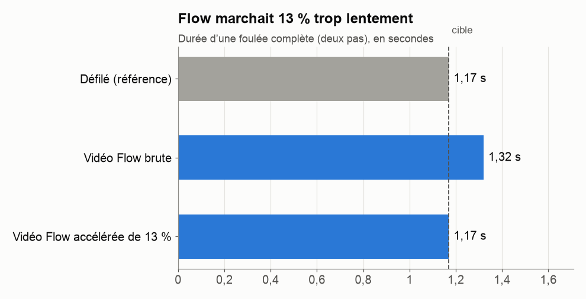

# 5. La vidéo Flow : un refus, un rythme trop lent

[← Chapitre précédent](04-premier-essai-pantin.md) · [Sommaire](../README.md) · [Chapitre suivant →](06-heroine-en-kirigami.md)

## L'idée : donner le mouvement à une IA vidéo

Plutôt que d'articuler un pantin, on demande à une IA vidéo de **filmer** l'Héroïne en train de marcher. **Google Flow** propose un modèle, **Omni Flash**, qui accepte deux choses à la fois :
- une **vidéo de référence** pour le mouvement ;
- une **image** du personnage pour l'apparence.

On lui écrit ensuite un texte (le **prompt**) : *« Applique la pose et le mouvement de la vidéo de référence à la femme de l'image de référence. »*

## Préparer la vidéo de référence

Claude a fabriqué la vidéo de référence à partir des 14 images du cycle :
- recadrée au format **vertical 9:16** ;
- bords gris et logo de la chaîne de mode **effacés** ;
- cycle répété 7 fois, soit environ **8 secondes** ;
- chaque image tenue deux fois, pour garder le rythme à 12 dessins par seconde.

Le prompt détaillait aussi le mouvement de la robe : *« lainage ferme, elle bascule mais ne flotte jamais ; l'ourlet s'incline d'environ 30° de chaque côté »*. Il décrivait le style (« animation des années 90, traits noirs nets, aplats ») et les interdits (« ne copie pas le visage de la vraie mannequin, ni le décor, ni les logos »).

## Problème n° 1 : la génération refusée

Claude a lancé la génération dans Flow, dans le navigateur de la DA, après lui avoir demandé son accord, puisque chaque vidéo coûte des crédits. Réponse de Flow :

> *Échec : cette demande pourrait enfreindre nos règles sur la génération de personnes connues.*

Le prompt ne nommait personne, et l'image du personnage était un dessin. Le problème venait de la vidéo de référence : on y voyait **le vrai visage de la mannequin**, et Flow refuse tout ce qui pourrait servir à imiter une personne réelle.

**Solution :** Claude a fabriqué une nouvelle vidéo de référence où **la tête est recouverte d'un ovale gris uni**. Le corps et la robe bougent toujours, mais personne n'est reconnaissable. Deuxième essai : **accepté**.

> **Leçon :** les IA ont des **règles de sécurité**, qui servent à protéger des personnes réelles. Quand une demande est refusée, ne cherche pas à « tromper » l'outil : cherche ce qui pose problème. Ici, masquer le visage, c'était exactement ce qu'il fallait faire : on n'avait de toute façon besoin que du mouvement.

## Problème n° 2 : le rythme

La vidéo obtenue était belle : bon personnage, bonne robe, démarche croisée de défilé. Mais Claude a mesuré la **durée d'une foulée**, en suivant le balancement de l'ourlet et la position des pieds image par image :



Flow faisait marcher l'Héroïne **13 % trop lentement**. Sur 8 secondes, cela fait une foulée de moins que sur le défilé.

**Solution sans IA :** on accélère simplement la vidéo, de 13,3 %, puis on garde un dessin sur deux, tenu deux images :

```bash
# accélérer de 13,27 %, passer à 12 dessins par seconde, puis encoder à 24 images par seconde
ffmpeg -i flow.mp4 -vf "setpts=PTS/1.1327,fps=12,fps=24" -af "atempo=1.1327" flow_corrige.mp4
```

Après correction, la foulée mesurée est de **1,169 s**, pour une cible de 1,167 s. Et la vidéo compte maintenant exactement **87 dessins** différents, chacun tenu deux images : 7,25 secondes.

> **Leçon :** **tout ne demande pas une IA.** Accélérer une vidéo, c'est une ligne de commande, gratuite et instantanée. Regénérer la vidéo aurait coûté des crédits, avec un résultat incertain.

## Ce qui n'a pas pu être corrigé

L'ourlet de la robe balance moins que sur le défilé (environ ±17°, contre ±25 à 30°). Accélérer la vidéo ne change pas l'amplitude d'un mouvement. Il aurait fallu une nouvelle génération, et la DA a préféré garder cette version.

## Bilan de l'étape

- **87 dessins** de l'Héroïne, au bon rythme : c'est la nouvelle base de travail.
- Mais c'est encore une vidéo d'anime « normale », pas du papier découpé. Le décor (un parquet et des fleurs) ne ressemble pas non plus au vrai défilé.

[Chapitre suivant : l'Héroïne en papier découpé →](06-heroine-en-kirigami.md)
