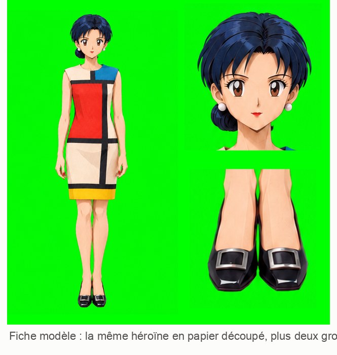

# 6. L'Héroïne en papier découpé, dessin par dessin

[← Chapitre précédent](05-la-video-flow.md) · [Sommaire](../README.md) · [Chapitre suivant →](07-le-decor.md)

## Le principe : une génération par dessin

Pour transformer l'Héroïne en kirigami, Codex utilise **GPT Image**, une IA qui génère des images. Pour **chacun des 87 dessins**, il lance une génération séparée en lui donnant plusieurs images, chacune avec un **rôle précis** :

| Image donnée à GPT Image | Son rôle |
|---|---|
| Le dessin Flow de cet instant | **L'autorité** pour la pose, le cadrage, les jambes, les pieds |
| La fiche modèle kirigami | L'apparence et la matière papier |
| Un gros plan du visage | Garder le même visage partout |
| Le dessin kirigami précédent, déjà validé | La continuité d'une image à l'autre |

Préciser le rôle de chaque image est essentiel. Sinon, l'IA peut copier la **pose** de la fiche modèle au lieu de celle du dessin Flow.

## D'abord, la fiche modèle

Avant tout, Codex fabrique une **fiche modèle** : l'Héroïne en pied, de face, sur fond vert, avec deux gros plans (visage et escarpins). Cette fiche fixe l'apparence pour tout le reste : cheveux en couches de papier, robe en carton de couleur, perles en papier roulé, escarpins en papier verni.

## Les leçons d'un projet précédent

Le même genre de chaîne avait déjà servi pour un autre projet, [Elfe](https://github.com/Bakann/elfluxe). Claude a repris dans le brief ce que ce projet avait appris :

- **Ne jamais zoomer ni recentrer le personnage** : garder exactement les marges du dessin Flow, sinon l'animation tremble.
- **GPT Image inverse souvent les jambes.** Il faut suivre chaque jambe de la hanche à la chaussure, et vérifier laquelle passe devant.
- **Si un pied est flou** (pendant un pas rapide), l'IA invente un pied posé à la mauvaise hauteur. Solution : coller sur le dessin Flow une chaussure nette, au bon endroit, et s'en servir comme guide.
- Les images générées font environ **941 × 1 672 pixels** : il faut les agrandir pour l'export en 1080 × 1920.

> **Leçon :** **garde une trace de ce que tu apprends.** Un projet bien documenté rend le suivant beaucoup plus rapide.

## L'essai sur une foulée, puis l'arrêt

Codex a commencé par les **14 premiers dessins** seulement, une foulée complète, puis il s'est arrêté. Claude a mesuré :
- **cadrage** : l'Héroïne tombe à la place exacte du dessin Flow, à 1 pixel près ;
- **ourlet** : du bon côté sur les 14 dessins, à 1,1° près ;
- **pieds et jambe avant** : identiques au dessin Flow ;
- **visage** : le même sur les 14 dessins.

Un seul point faible : l'effet papier restait léger. Après une petite retouche (une raie de peau visible dans les cheveux), l'essai a été mis de côté le temps de régler le décor (chapitre 7). Une fois le décor validé, Codex a produit les **73 dessins restants**.

## La production des 87 dessins

- **73 générations**, une par dessin, plus une de correction : un ourlet dépassait la tolérance de 5° et a été régénéré.
- Les **14 premiers dessins** validés sont repris tels quels, sans les régénérer.
- Chaque dessin est contrôlé : ourlet (écart maximal 4,7°), pied le plus bas, jambe de devant, motif de la robe, visage.

Chaque dessin est produit **sur fond vert**, puis l'ordinateur retire ce vert pour obtenir l'Héroïne seule, avec un fond **transparent**. C'est la technique de l'**incrustation**, utilisée au cinéma et à la météo à la télévision. On peut ainsi la poser sur n'importe quel décor.

## Ce qui reste imparfait

Codex le signale lui-même, sans le cacher :
- le visage garde un léger grain de papier et de petites facettes ;
- les traits et les mèches varient un peu d'un dessin à l'autre, puisque chaque image est générée séparément ;
- quelques escarpins sont un peu plus massifs que dans Flow.

> **Leçon :** une IA honnête **liste ses défauts** au lieu de dire « tout est parfait ». Demande-le explicitement dans tes consignes : *« ne présente jamais un défaut comme résolu »*.

[Chapitre suivant : le décor →](07-le-decor.md)
