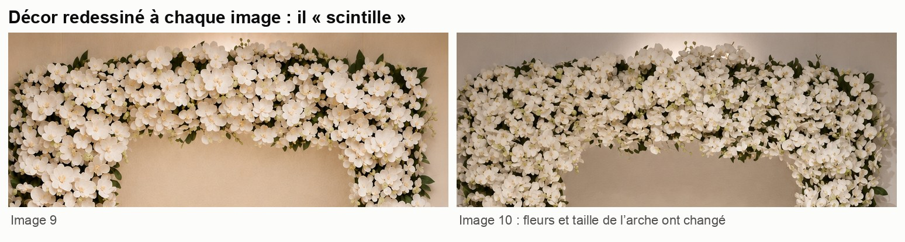
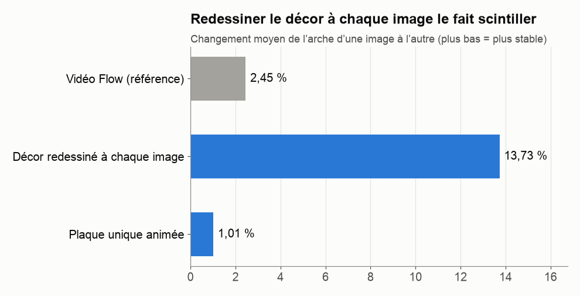
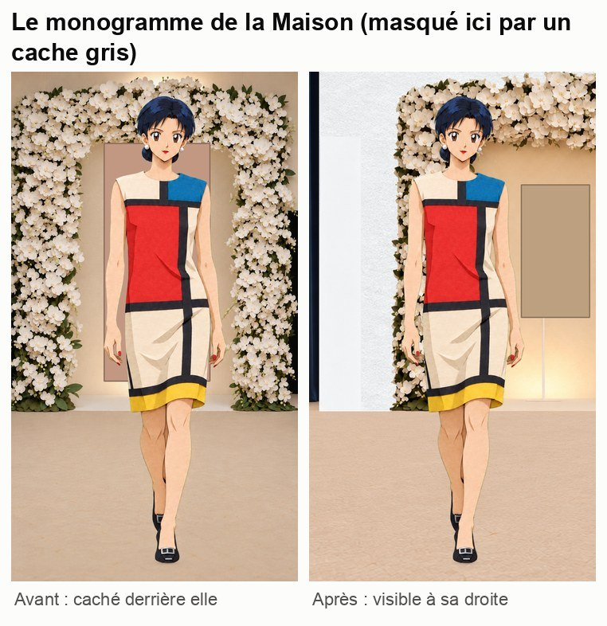
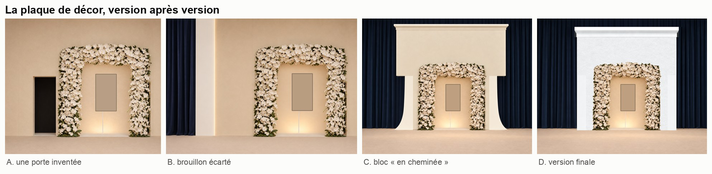
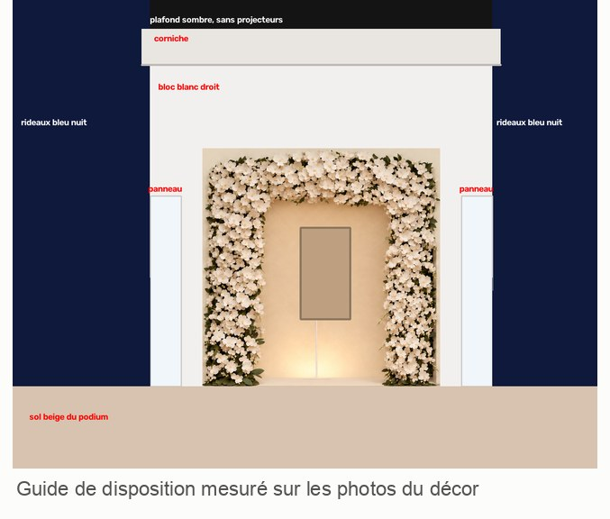
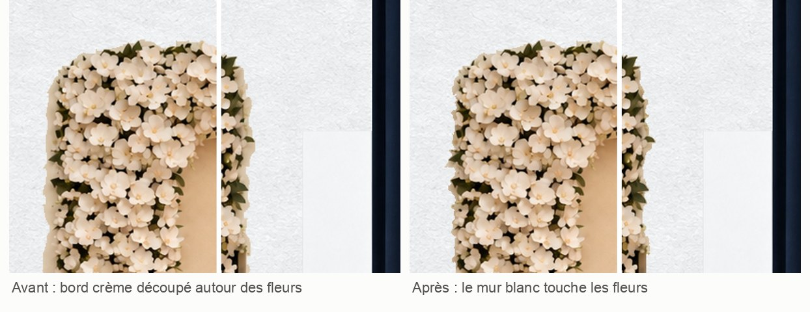
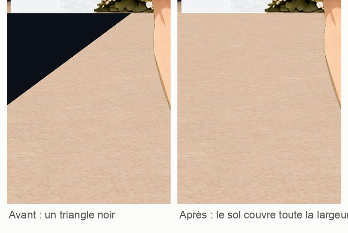

# 7. Le décor : six problèmes, six solutions

[← Chapitre précédent](06-heroine-en-kirigami.md) · [Sommaire](../README.md) · [Chapitre suivant →](08-les-pieds-qui-glissent.md)

C'est l'étape qui a demandé le plus de versions : cinq en tout. Chaque problème est raconté ici avec sa solution.

## Le point de départ : une vidéo de décor vide

La DA a fourni deux photos du vrai décor : une arche couverte d'orchidées blanches et le monogramme de la Maison au milieu. Claude a découpé dans ces photos uniquement le décor, sans la mannequin ni la mention de l'agence photo, puis a demandé à Flow :

> *Une vidéo de ce décor de défilé **vide**, sans personne. La caméra recule doucement au rythme d'une marche, comme si elle suivait une mannequin qui avance vers elle.*

Flow a produit 8 secondes de travelling arrière, avec l'arche qui rapetisse et le sol qui défile. Claude en a extrait **87 images**, synchronisées avec les 87 dessins de l'Héroïne.

Un défaut : à partir de 5 secondes, Flow a ajouté **des jambes de spectateurs** au bord de l'image, et un projecteur en haut. Il faudra les effacer.

## Problème 1 : le décor qui scintille

Première idée : faire redessiner chaque image du décor en kirigami par GPT Image, comme pour l'Héroïne. Le résultat était joli image par image, mais **en animation, le décor tremblait** : à chaque image, les fleurs changeaient de forme et de place.

Codex a **mesuré** ce scintillement : de combien l'arche change d'une image à l'autre, une fois le mouvement de la caméra compensé.

Le décor redessiné changeait **5,6 fois plus** que la vidéo Flow d'origine.

**Pourquoi :** chaque génération est indépendante. L'IA ne se souvient pas de la position exacte de chaque fleur dans l'image précédente.

**Solution (proposée par Codex) :** ne dessiner le décor **qu'une seule fois**, sous forme d'une grande **plaque** en haute définition, puis la **déplacer et la réduire** image par image pour imiter le recul de la caméra. Les fleurs sont toujours les mêmes, il n'y a donc plus de scintillement : **1 %**, encore moins que la vidéo Flow.

> **Leçon :** **ce qui ne bouge pas ne doit pas être regénéré.** Une IA de génération recrée tout à chaque fois. Pour un élément fixe, il vaut mieux le fabriquer une fois et l'animer avec un programme.

## Problème 2 : le logo caché derrière l'Héroïne

Le monogramme de la Maison est au centre de l'arche… exactement derrière l'Héroïne, qui en cachait 70 à 85 %. Or sur la vidéo du défilé, on le voyait bien à côté de la mannequin.

**Solution :** décaler **tout le décor** de 360 pixels vers la droite, sans bouger l'Héroïne. Le monogramme passe alors à sa droite. Codex vérifie sur chaque image qu'il n'est **jamais caché**, avec au moins 43 pixels de marge.

## Problème 3 : une porte sortie de nulle part

En décalant le décor, il fallait inventer la partie gauche, qui n'existait pas dans la vidéo Flow. Claude a écrit dans le brief : *« mur, coulisse noire et suite du podium »*. Codex a pris « coulisse noire » au pied de la lettre et a dessiné **une porte noire isolée** au milieu du mur (image A ci-dessous).

**Solution :** Claude a reconnu son erreur, corrigé le brief (« un simple prolongement du mur, sans porte ni ouverture ») et Codex a retiré la porte.

> **Leçon :** **chaque mot d'une consigne compte.** Une IA de génération transforme chaque mot en quelque chose de visible. Si tu ne veux pas d'un objet, ne le nomme pas, même en passant.

## Problème 4 : un décor qui ne ressemble pas au vrai

La DA a fourni deux nouvelles photos du décor, prises de plus loin. On y voyait que l'arche était posée dans un **bloc de murs blancs**, avec des **rideaux bleu nuit** de chaque côté. Codex a fait une nouvelle plaque… et la DA a répondu : **« ça ne ressemble pas du tout aux deux images »**.

En comparant, Claude a vu que l'image montrée était un **brouillon** (B) que Codex avait déjà écarté. Mais la plaque retenue (C) n'était pas juste non plus : le bloc avait une forme de **cheminée**, le mur au-dessus de l'arche était trop haut, et la couleur trop crème.

**Solution :** au lieu de redécrire le décor avec des mots, Claude a **mesuré les proportions** sur les photos : largeur du bloc par rapport à l'arche, hauteur du mur, position des panneaux. Il a ensuite dessiné un **guide de disposition**, un simple schéma en aplats avec l'arche au bon endroit. Codex a reconstruit la plaque en suivant ce schéma (D).

> **Leçon :** **un schéma vaut mieux qu'un long texte.** Pour une question de proportions, donne des mesures et un dessin, pas des adjectifs.

## Problème 5 : les finitions, liseré crème et triangle noir

En regardant de près, deux défauts restaient :

**Un liseré crème autour des fleurs.** Les fleurs avaient été découpées dans l'ancienne version, au fond crème, et en gardaient un contour, comme un autocollant sur le mur blanc. Codex l'a remplacé par le papier du mur. Il est passé de 4 891 pixels crème à **0**.

**Un triangle noir sur le sol**, repéré par la DA. Le podium de Flow était plus étroit que l'image et laissait voir la salle sombre. Codex a élargi le sol pour qu'il couvre toute la largeur, sur les 87 positions de la caméra.

## Problème 6 : le décor qui « revient en arrière »

En regardant l'essai en boucle, la DA a vu le décor **reculer, puis revenir d'un coup** à sa position de départ.

Ce n'était pas un défaut des images. La caméra recule pendant tout le plan sans jamais revenir, donc quand l'aperçu reprend au début, l'arche retrouve d'un coup sa taille. Deux options :
1. **un plan continu** de 7,25 secondes, sans boucle, qui garde le recul de la caméra ;
2. **une boucle parfaite** avec un décor immobile, mais il faudrait alors refaire l'Héroïne sur une seule foulée répétée.

La DA a choisi le **plan continu**, et plus aucun aperçu ne boucle.

## Une erreur de plus de Claude

Pendant la fabrication du sol, Codex a posé une question : *« Le sol de Flow remonte d'environ 5 pixels par dessin, alors que le brief demande un défilement vers le bas. Lequel retenir ? »*

C'est Codex qui avait raison. Quand la caméra recule, le sol **s'éloigne et remonte** vers l'horizon. Claude s'était trompé de sens dans le brief.

> **Leçon :** **encourage les IA à poser des questions** quand une consigne contredit ce qu'elles observent. Une IA qui obéit aveuglément aurait fabriqué un sol qui défile à l'envers.

[Chapitre suivant : les pieds qui glissent →](08-les-pieds-qui-glissent.md)
