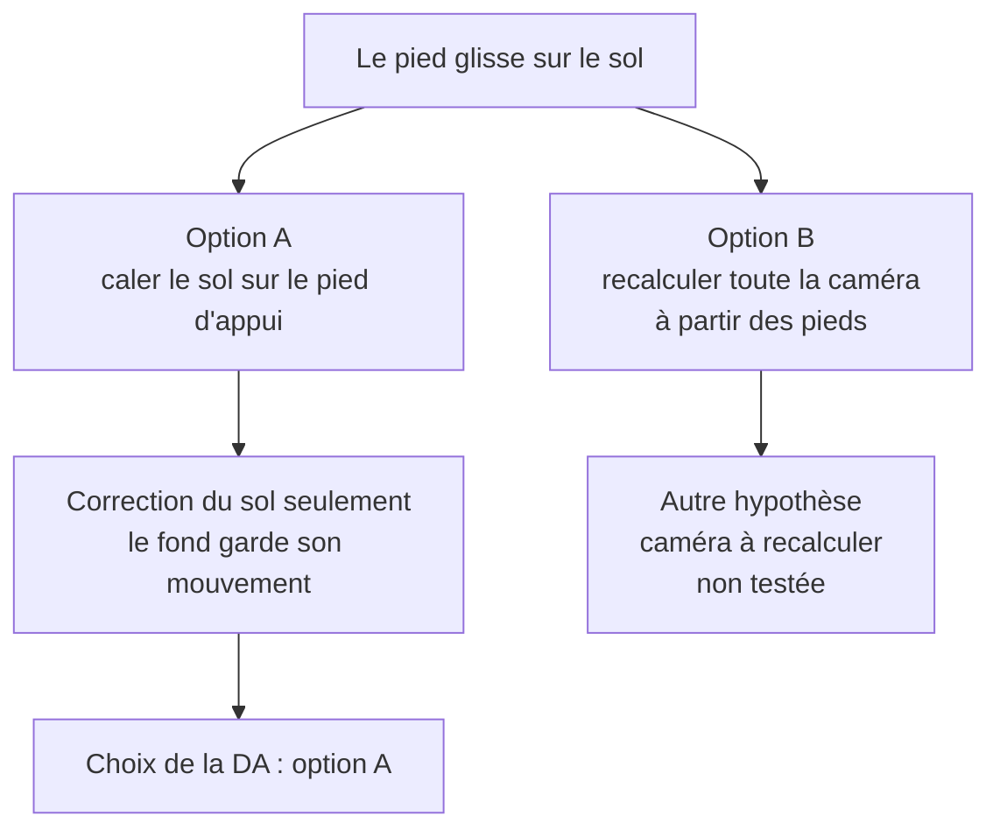
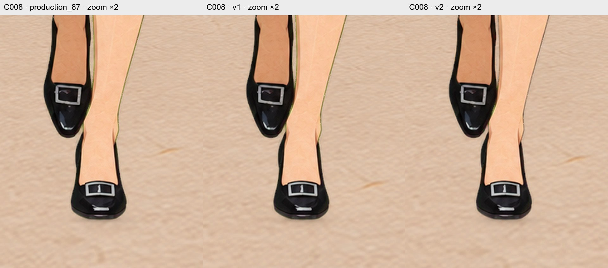
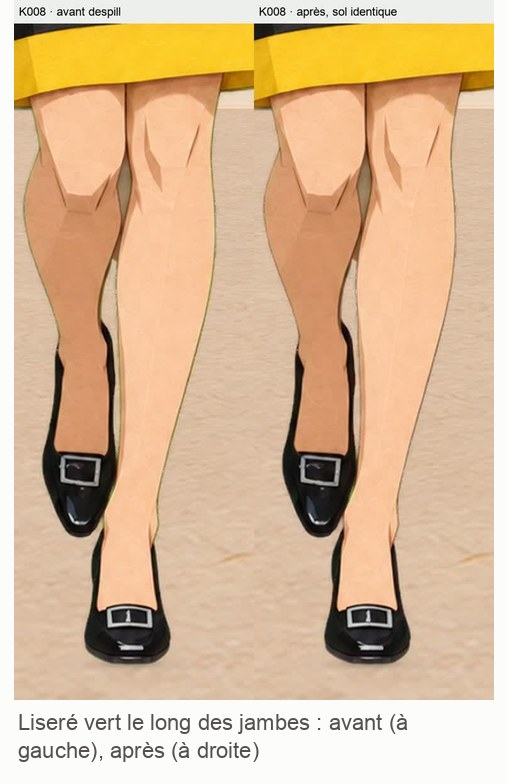
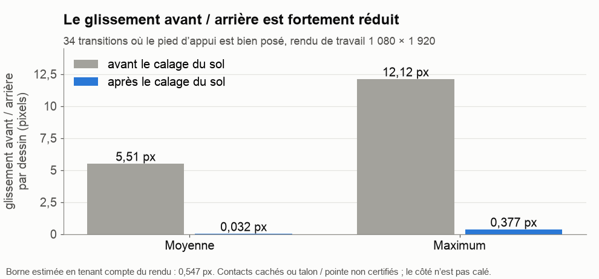

# 8. Les pieds qui glissent : le défaut le plus subtil

[← Chapitre précédent](07-le-decor.md) · [Sommaire](../README.md) · [Chapitre suivant →](09-ta-methode.md)

## Le symptôme

La séquence complète était terminée, avec 87 dessins dans leur décor. En la regardant, la DA a dit : **« les pieds glissent trop »**. Le pied posé au sol semblait patiner légèrement, comme sur de la glace.

## Pourquoi ça glisse

Deux choses bougent indépendamment l'une de l'autre :
- **l'Héroïne**, collée exactement à la position de ses dessins Flow ;
- **le sol**, qui défile selon le mouvement de caméra que Codex avait calculé à partir de l'**arche**.

Or la vidéo Flow n'est pas une vraie scène filmée : ses pieds et son décor ne sont pas parfaitement cohérents entre eux. Résultat : sous le pied posé, le papier du sol avançait en moyenne **5,5 pixels par dessin** (jusqu'à 12) de trop ou de pas assez, dans le rendu de travail 1 080 × 1 920.

## Deux options

Contrainte : **ne pas toucher à l'Héroïne**, dont les 87 dessins étaient validés. Il faut donc que ce soit le sol qui s'adapte.

**L'idée de l'option A :** on repère le point où la chaussure touche le sol (le point le plus bas de la chaussure). Pendant que le pied est posé, ce point ne doit pas bouger *par rapport au papier du sol*. On fait donc glisser la texture du sol, image par image, juste ce qu'il faut pour qu'elle suive le pied.

## Premier essai : ça marche… avec un effet secondaire

Sur les 14 premiers dessins, le glissement est tombé à **0,4 pixel**. Mais en lisant les chiffres image par image, Claude a vu un problème : aux dessins 11 à 13, le point de contact **sautait de 34 pixels sur le côté**.

Le pied ne bougeait pas. C'est le **point le plus bas** qui changeait : le talon d'abord, puis la pointe, quand le pied se déroule. Le sol suivait ce saut à la lettre et faisait une petite **embardée** de côté : 11 pixels à droite, puis 9 à gauche.

## Deuxième essai : séparer les directions

Le glissement que la DA voyait était un glissement **avant / arrière**. Aucune raison, donc, de caler aussi le mouvement de côté. Nouvelle règle :
- **avant / arrière** : calage strict sur le pied d'appui ;
- **de côté** : une courbe lisse sur toute la séquence, sans aller-retour ;
- **passage du talon à la pointe** : transition douce sur 2 à 3 dessins, au lieu de suivre le point le plus bas à la lettre.

Résultat sur l'essai de 14 dessins : glissement avant / arrière toujours sous 1 pixel, pas de côté du sol sous 1 pixel, et plus d'embardée.

## Le bonus : un liseré vert repéré par Claude

En vérifiant les pieds, Claude a remarqué un **fin liseré vert-olive** tout autour de l'Héroïne, le long des jambes et des bras. C'est un reste du fond vert de l'incrustation, présent sur les 87 images.

Le contrôle automatique de Codex ne le voyait pas : il ne cherchait que du vert **franc**, alors que ce liseré était **jaune-vert**. Codex a ensuite remplacé la couleur de ces pixels de bord par celle de la peau ou de la robe voisine, sans toucher à la forme de l'Héroïne.

> **Leçon :** **un contrôle automatique ne trouve que ce qu'on lui a demandé de chercher.** Si le seuil est mal choisi, il affiche « 0 défaut » alors que le défaut est bien là. Regarde toujours aussi les images en gros plan.

## Sur les 87 images : un compromis à trancher

En appliquant la méthode aux 87 dessins, Codex a rencontré un **conflit**. Pour certains pas, garder le glissement avant / arrière sous 1 pixel **obligeait** le bord du sol à bouger de plus d'1 pixel de côté. Il l'a démontré par le calcul, puis a proposé trois options en recommandant de **privilégier l'avant / arrière**. La DA a demandé son avis à Claude, qui a conseillé la même option, puisque c'est le défaut que la DA voyait. La DA a choisi cette option, en gardant une courbe de côté lissée et en faisant chiffrer ses dépassements.

**Résultat**, en pixels du rendu de travail 1 080 × 1 920 (la vidéo publiée ici est réduite à 540 × 960) :
- sur 34 **transitions** (passages d'un dessin au suivant) où le pied d'appui est bien posé et visible, le glissement avant / arrière passe de **5,51 px** à **0,032 px** en moyenne, et de 12,12 à 0,377 px au maximum. Une vérification sur le grain du sol réellement rendu donne une borne de 0,547 px, sous le seuil de 1 px ;
- ce résultat ne certifie pas tout : 15 dessins n'ont pas de point de contact mesurable, et 25 sont des passages talon / pointe traités en douceur. Le glissement **de côté** des pieds n'est pas calé ;
- en contrepartie, la courbe de côté du sol, bien que lissée, bouge encore de plus d'1 pixel sur 51 transitions sur 86, jusqu'à 4,84 px au bord du sol, avec quelques changements de sens. Les à-coups près des pieds augmentent un peu (de 15,3 à 16,8 px par dessin²) ;
- le grain du sol se décale aussi par rapport au pied du mur, comme un tapis roulant : à la dernière image, +5,30 px horizontalement et +18,12 px verticalement au centre. C'est une limite du résultat.

> **Leçon :** **on ne peut pas toujours tout avoir.** Quand deux objectifs s'opposent, il faut choisir lequel compte le plus pour le résultat, et l'écrire. Ici, la règle était : « ce que l'œil remarque passe en premier ».

## Fin de l'aventure

Après la validation de l'essai court et ce choix de priorité, Codex a livré les 87 dessins avec ces limites documentées. La DA a regardé la séquence complète et l'a validée : « Je valide la séquence finale calée. » C'est la vidéo en tête du [README](../README.md).

[Chapitre suivant : à toi de jouer, la méthode →](09-ta-methode.md)
