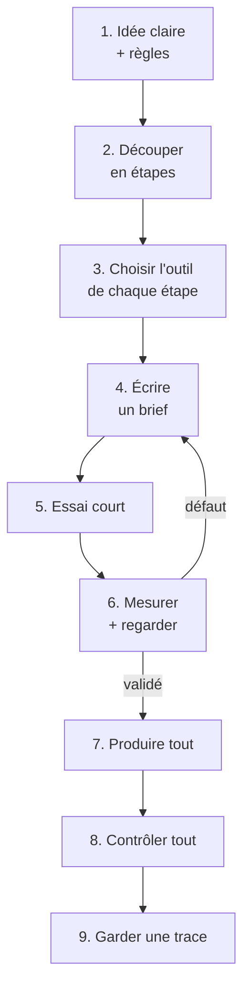

# 9. À toi de jouer : la méthode réutilisable

[← Chapitre précédent](08-les-pieds-qui-glissent.md) · [Sommaire](../README.md) · [Chapitre suivant →](10-glossaire.md)

Tu n'as pas besoin d'un défilé de mode pour réutiliser cette méthode. Elle marche pour un clip, une bande dessinée animée, un jeu vidéo, une affiche, un exposé… Voici la recette, étape par étape.

## La boucle de base



### 1. Une idée claire, et des règles

Écris en quelques lignes **ce que tu veux obtenir** : format, durée, style. Écris aussi **ce que tu ne veux pas** : par exemple, ne montrer aucune personne réelle, ou ne publier que des images que tu as le droit de publier.

### 2. Découper en petites étapes

Un grand projet d'IA, c'est une suite de petites transformations. Ici : comprendre la marche → vidéo → personnage → décor → corrections. Chaque étape a une **entrée** et une **sortie** bien définies.

### 3. Une IA par métier

| Besoin | Type d'outil |
|---|---|
| Comprendre, planifier, écrire des consignes, vérifier | Un assistant conversationnel (Claude, ChatGPT…) |
| Écrire et lancer des programmes, enchaîner des tâches | Un agent de code (Codex, Claude Code…) |
| Générer des images fixes | Une IA d'images (GPT Image…) |
| Générer une vidéo fluide | Une IA vidéo (Flow, Veo…) |
| Découper, accélérer, assembler des vidéos | **Pas d'IA** : ffmpeg, un logiciel de montage |

N'utilise pas une IA pour ce qu'un simple programme fait mieux.

### 4. Écrire un bon brief

Un brief est un **fichier texte** que l'IA lit avant de travailler. Voici un modèle :

```markdown
# Titre de l'étape

## Objectif
Ce que je veux obtenir, en une ou deux phrases.

## Entrées (ne pas modifier)
- fichier A : rôle (par exemple « autorité pour la pose »)
- fichier B : rôle (par exemple « apparence seulement »)

## Consignes
1. …
2. …

## À ne pas faire
- …

## Contrôles à faire sur chaque image
- sommet de la tête : moins de 5 pixels d'écart avec la source
- pied posé : moins de 5 pixels d'écart avec la source

## Livrables
- dossier, noms de fichiers, formats

Commence par un essai sur [une petite partie], puis ARRÊTE-TOI et attends ma validation.
Ne présente jamais un défaut comme résolu : liste ce qui reste imparfait.
```

Les réflexes qui ont le plus servi dans ce projet :
- **donner un rôle à chaque image de référence** (« la pose vient de celle-ci, l'apparence de celle-là ») ;
- **décrire avec des chiffres et des schémas** plutôt qu'avec des adjectifs ;
- **décrire d'abord ce qui doit être visible**, puis vérifier sur un essai qu'une interdiction a bien été comprise (souviens-toi de la porte du chapitre 7) ;
- **demander à l'IA de s'arrêter** après l'essai ;
- **demander la liste des défauts restants**.

### 5. Toujours un essai court

Ici, l'essai portait sur 14 images avant de passer aux 87. Si l'essai rate, tu as perdu peu de temps et peu de crédits.

### 6. Mesurer *et* regarder

- **Mesurer** attrape ce que l'œil ne voit pas : la robe trop courte, la marche trop lente, le liseré vert.
- **Regarder** attrape ce que les mesures ne disent pas : le pantin tout juste mais laid, la porte inventée, le décor qui revient en arrière.

Il faut les deux. Et fais vérifier les mesures par **un autre outil** que celui qui a produit le résultat : il doit refaire la mesure, pas recopier le résultat.

### 7 et 8. Produire tout, puis contrôler tout

Une fois l'essai validé, lance la production complète avec **exactement la même méthode**. Puis refais les contrôles sur l'ensemble : certains problèmes n'apparaissent que sur la longueur, comme le conflit de seuils du chapitre 8.

### 9. Garder une trace

Garde **toutes les versions** (v1, v2, v3…) au lieu d'écraser les anciennes, et note **les décisions** prises et leurs raisons. Ça permet de revenir en arrière, de comparer, et de réutiliser ce que tu as appris dans le projet suivant.

## Ton premier essai : six dessins, une demi-seconde

Voici un exercice que tu peux faire de bout en bout. Choisis un personnage ou un petit objet que **tu as créé**. Filme-le toi-même, sans personne, sans musique ni œuvre de quelqu'un d'autre. Le but est simple : **changer son apparence tout en gardant son mouvement**.

1. **Prépare le dossier.** Installe FFmpeg, crée un dossier de projet et ouvre le terminal dedans. Crée trois sous-dossiers : `entrees`, `sorties/essai_01` et `controle`. Place ta vidéo dans le dossier du projet sous le nom `ma_video.mp4`. Ne modifie jamais les fichiers d'entrée.
2. **Extrais six dessins à 12 dessins par seconde**, à partir de la seconde 1 :

   ```bash
   ffmpeg -ss 1 -i ma_video.mp4 -vf fps=12 -frames:v 6 entrees/image_%03d.png
   ```

   Six dessins à 12 par seconde, ça fait 6 ÷ 12 = 0,5 seconde.
3. **Écris un brief concret**, par exemple : « Entrée A : cette image décide de la pose et du cadrage. Entrée B : mon modèle décide de l'apparence. Change la matière en papier. Garde le cadre entier, sans zoom ni déplacement. Commence par six dessins, puis arrête-toi. »
4. **Choisis deux repères visibles**, par exemple le sommet de l'objet et son point de contact avec le sol. Compare la source et le résultat à la même taille, sans les réaligner. Exemple de tolérance pour une image de 720 × 1 280 : 5 pixels sur chaque repère. C'est un choix de départ, à adapter à ton projet. Regarde aussi les six dessins à la suite : une mesure correcte ne garantit pas un bel effet.
5. **Assemble l'essai.** Range les six résultats dans `sorties/essai_01` avec les mêmes noms (`image_001.png` à `image_006.png`), puis :

   ```bash
   ffmpeg -framerate 12 -start_number 1 -i sorties/essai_01/image_%03d.png -frames:v 12 -vf fps=24 -an -c:v libx264 -pix_fmt yuv420p essai_01.mp4
   ffprobe -v error -select_streams v:0 -count_frames -show_entries stream=nb_read_frames,r_frame_rate,width,height:format=duration -of default=noprint_wrappers=1 essai_01.mp4
   ```

   Le contrôle doit annoncer `nb_read_frames=12`, `r_frame_rate=24/1` et `duration=0.500000` : six dessins, chacun affiché deux fois, sans son ni boucle.
6. **Décide, et note ta décision** dans `controle/decisions.md` : date, défaut observé, mesure, capture, correction demandée, personne qui valide. Si un repère dépasse la tolérance ou si l'animation tremble, garde cet essai et ne corrige **qu'une seule** consigne avant de recommencer. Sinon, passe à une séquence plus longue, puis refais les contrôles.

Un autre outil peut vérifier la durée avec ffprobe, et une superposition source / résultat peut contrôler les repères. Utiliser deux IA ne rend pas automatiquement leurs conclusions indépendantes : ne laisse pas l'une recopier les mesures de l'autre sans les refaire.

## Les erreurs les plus fréquentes, et leurs remèdes

| Problème | Ce qu'on a vu ici | Remède |
|---|---|---|
| L'IA invente des choses | Une porte, des spectateurs, des semelles | Décrire précisément ce qui doit être visible, puis vérifier l'essai |
| L'animation tremble | Décor qui scintille | Ne générer qu'une fois ce qui ne bouge pas |
| Les jambes s'inversent | Squelette, pieds | Regarder les images voisines ; suivre chaque jambe |
| Refus de l'IA | Le visage d'une personne réelle | Chercher ce qui pose problème ; retirer ce dont on n'a pas besoin (ici le visage) |
| Mauvais rythme | Marche trop lente | Mesurer, puis corriger sans IA (ffmpeg) |
| Contrôle qui rate un défaut | Liseré vert-olive | Regarder en gros plan ; vérifier avec un autre outil |
| Deux objectifs incompatibles | Glissement contre pas de côté | Choisir une priorité et l'écrire |

## Le temps et le coût

- **Temps :** deux jours, en grande partie à attendre les générations, regarder les résultats et décider.
- **Crédits :** quelques dizaines de crédits Flow, et plus d'une centaine de générations d'images. Les essais courts ont évité d'en gaspiller beaucoup plus.
- **Le plus long, c'est la vérification.** C'est normal : c'est elle qui fait la qualité du résultat.

## Idées de projets pour te lancer

- Faire marcher ton personnage dessiné comme dans une vidéo que tu as **filmée toi-même** : tu maîtrises ta source. Vérifie quand même les autorisations nécessaires pour les personnes, les œuvres et les sons présents avant de publier.
- Transformer une courte vidéo de sport en animation « style manga » à 12 dessins par seconde.
- Créer un décor en papier découpé pour une scène de théâtre filmée.
- Raconter ton projet comme ici, avec ses ratés : c'est souvent la partie la plus utile pour les autres.

[Chapitre suivant : petit glossaire →](10-glossaire.md)
