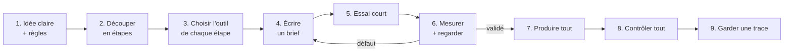

# 9. À toi de jouer : la méthode réutilisable

[← Chapitre précédent](08-les-pieds-qui-glissent.md) · [Sommaire](../README.md) · [Chapitre suivant →](10-glossaire.md)

Tu n'as pas besoin d'un défilé de mode pour réutiliser cette méthode. Elle marche pour un clip, une bande dessinée animée, un jeu vidéo, une affiche, un exposé… Voici la recette, étape par étape.

## La boucle de base



### 1. Une idée claire, et des règles

Écris en quelques lignes **ce que tu veux obtenir** : format, durée, style. Écris aussi **ce que tu ne veux pas** : par exemple, ne montrer aucune personne réelle, ou ne publier que des images que tu as le droit de publier.

### 2. Découper en petites étapes

Un grand projet d'IA, c'est une suite de petites transformations. Ici : comprendre la marche → vidéo → personnage → décor → corrections. Chaque étape a une **entrée** et une **sortie** bien définies.

### 3. Une IA par métier

| Besoin | Type d'outil |
|---|---|
| Comprendre, planifier, écrire des consignes, vérifier | Un assistant conversationnel (Claude, ChatGPT…) |
| Écrire et lancer des programmes, enchaîner des tâches | Un agent de code (Codex, Claude Code…) |
| Générer des images fixes | Une IA d'images (GPT Image…) |
| Générer une vidéo fluide | Une IA vidéo (Flow, Veo…) |
| Découper, accélérer, assembler des vidéos | **Pas d'IA** : ffmpeg, un logiciel de montage |

N'utilise pas une IA pour ce qu'un simple programme fait mieux.

### 4. Écrire un bon brief

Un brief est un **fichier texte** que l'IA lit avant de travailler. Voici un modèle :

```markdown
# Titre de l'étape

## Objectif
Ce que je veux obtenir, en une ou deux phrases.

## Entrées (ne pas modifier)
- fichier A : rôle (par exemple « autorité pour la pose »)
- fichier B : rôle (par exemple « apparence seulement »)

## Consignes
1. …
2. …

## À ne pas faire
- …

## Contrôles à faire sur chaque image
- mesure 1 : seuil
- mesure 2 : seuil

## Livrables
- dossier, noms de fichiers, formats

Commence par un essai sur [une petite partie], puis ARRÊTE-TOI et attends ma validation.
Ne présente jamais un défaut comme résolu : liste ce qui reste imparfait.
```

Les réflexes qui ont le plus servi dans ce projet :
- **donner un rôle à chaque image de référence** (« la pose vient de celle-ci, l'apparence de celle-là ») ;
- **décrire avec des chiffres et des schémas** plutôt qu'avec des adjectifs ;
- **ne pas nommer ce qu'on ne veut pas voir** (souviens-toi de la porte du chapitre 7) ;
- **demander à l'IA de s'arrêter** après l'essai ;
- **demander la liste des défauts restants**.

### 5. Toujours un essai court

Ici, l'essai portait sur 14 images avant de passer aux 87. Si l'essai rate, tu as perdu peu de temps et peu de crédits.

### 6. Mesurer *et* regarder

- **Mesurer** attrape ce que l'œil ne voit pas : la robe trop courte, la marche trop lente, le liseré vert.
- **Regarder** attrape ce que les mesures ne disent pas : le pantin tout juste mais laid, la porte inventée, le décor qui revient en arrière.

Il faut les deux. Et fais vérifier les mesures par **un autre outil** que celui qui a produit le résultat.

### 7 et 8. Produire tout, puis contrôler tout

Une fois l'essai validé, lance la production complète avec **exactement la même méthode**. Puis refais les contrôles sur l'ensemble : certains problèmes n'apparaissent que sur la longueur, comme le conflit de seuils du chapitre 8.

### 9. Garder une trace

Garde **toutes les versions** (v1, v2, v3…) au lieu d'écraser les anciennes, et note **les décisions** prises et leurs raisons. Ça permet de revenir en arrière, de comparer, et de réutiliser ce que tu as appris dans le projet suivant.

## Les erreurs les plus fréquentes, et leurs remèdes

| Problème | Ce qu'on a vu ici | Remède |
|---|---|---|
| L'IA invente des choses | Une porte, des spectateurs, des semelles | Consignes précises ; ne pas nommer ce qu'on ne veut pas |
| L'animation tremble | Décor qui scintille | Ne générer qu'une fois ce qui ne bouge pas |
| Les jambes s'inversent | Squelette, pieds | Regarder les images voisines ; suivre chaque jambe |
| Refus de l'IA | Personne connue | Comprendre la règle ; retirer ce qui pose problème (ici le visage) |
| Mauvais rythme | Marche trop lente | Mesurer, puis corriger sans IA (ffmpeg) |
| Contrôle qui rate un défaut | Liseré vert-olive | Regarder en gros plan ; vérifier avec un autre outil |
| Deux objectifs incompatibles | Glissement contre pas de côté | Choisir une priorité et l'écrire |

## Le temps et le coût

- **Temps :** deux jours, en grande partie à attendre les générations, regarder les résultats et décider.
- **Crédits :** quelques dizaines de crédits Flow, et une centaine de générations d'images. Les essais courts ont évité d'en gaspiller beaucoup plus.
- **Le plus long, c'est la vérification.** C'est normal : c'est elle qui fait la qualité du résultat.

## Idées de projets pour te lancer

- Faire marcher ton personnage dessiné comme dans une vidéo que tu as **filmée toi-même** : pas de problème de droits !
- Transformer une courte vidéo de sport en animation « style manga » à 12 dessins par seconde.
- Créer un décor en papier découpé pour une scène de théâtre filmée.
- Raconter ton projet comme ici, avec ses ratés : c'est souvent la partie la plus utile pour les autres.

[Chapitre suivant : petit glossaire →](10-glossaire.md)
